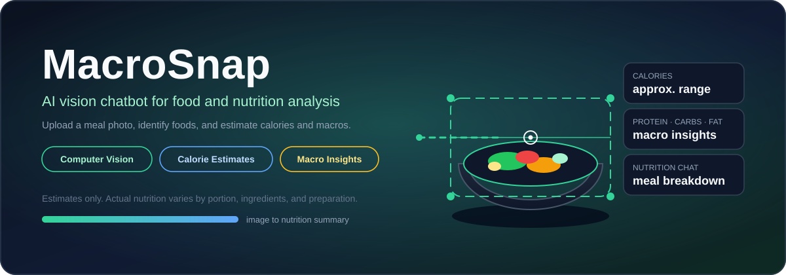

# MacroSnap — AI Vision Chatbot

**Built AI Vision Chatbot for Food & Nutrition Analysis**

> An AI-powered vision chatbot that analyzes food images and provides approximate calorie and macronutrient insights.



[](https://www.python.org/)
[](https://streamlit.io/)
[](https://ai.google.dev/gemini-api/docs)
[](https://github.com/abinesh-0/macrosnap-ai-vision-chatbot)
[](LICENSE)

[Overview](#overview) · [How it works](#how-it-works) · [Installation](#installation) · [Configuration](#configuration) · [Limitations](#important-limitations)

## Overview

MacroSnap turns a meal photo into a nutrition conversation. Upload an image, ask about the visible food, and receive a readable breakdown of estimated calories, protein, carbohydrates, and fat. Follow-up questions can add context about portions, ingredients, or preparation.

The application combines a Streamlit chat interface with Google's Gemini API. Its instructions emphasize visible evidence, uncertainty, and approximate nutrition ranges rather than exact measurements. You can also describe a meal in text when a photo is unavailable.

**Nutrition values are estimates, not medical advice.** A photo cannot reveal exact weight, hidden ingredients, or cooking oil. Actual values can vary substantially with portion size, cooking method, oil/ghee, sauces, dressings, and other additions.

## Main features

| Capability | What MacroSnap does |
| --- | --- |
| Food-image input | Accepts JPG, JPEG, and PNG meal photos in the chat composer. |
| Visual food identification | Asks the model to identify visible foods and acknowledge uncertain ingredients. |
| Calorie estimation | Requests approximate calorie ranges based on the meal and its apparent portions. |
| Macronutrient insights | Estimates protein, carbohydrates, and fat. |
| Readable meal breakdowns | Presents identified foods, estimated nutrition, and an uncertainty note. |
| Nutrition conversation | Supports text descriptions and follow-up questions within the current session. |

The code also includes a secondary Twilio WhatsApp summary action. Delivery depends on valid sender/template configuration, account permissions, and applicable trial or sandbox restrictions; it is **not guaranteed**. Food-image analysis and nutrition chat are the focus of this release.

## How it works

```text
User uploads food image
        ↓
AI Vision Model analyzes image
        ↓
Food items are identified
        ↓
Portion/food information is interpreted
        ↓
Calories and macros are estimated
        ↓
MacroSnap returns a readable nutrition summary
```

`app.py` sends the uploaded image bytes and question to a Gemini chat session. The system instructions in `prompts.py` guide the model to identify visible items, interpret likely portions, and return approximate nutrition ranges. Follow-up messages use that same session's conversation context.

These are conceptual stages of one model-driven conversation—not a separate object detector, food database lookup, or measured nutritional calculation.



*Illustrative workflow diagram only; not an application screenshot or a sample AI result. It remains readable when animation is unavailable and respects reduced-motion preferences.*

## Technology stack

| Technology | Role in this project |
| --- | --- |
| Python | Application language; locally verified with Python 3.13.5. |
| Streamlit | Web interface, image upload, chat rendering, and session state. |
| Google Gen AI SDK (`google-genai`) | Gemini multimodal chat and image-content requests. |
| Twilio Python SDK (`twilio`) | Existing secondary WhatsApp summary integration. |
| Git / GitHub | Version control and source hosting. |

The current model identifier in `app.py` is `gemini-3.5-flash-lite`. Access, quotas, pricing, and availability depend on your Google API account. The repository preparation does not change the existing model or API implementation.

The existing [`requirements.txt`](requirements.txt) lists the three direct runtime dependencies without version pins. The local verification environment uses Streamlit 1.64.0, google-genai 2.25.0, and Twilio 9.11.2. Fresh installations may resolve newer versions; these are environment details, not a compatibility guarantee.

## Project structure

```text
MacroSnap/
├── .streamlit/
│   └── secrets.toml.example   # Placeholder configuration only
├── assets/
│   ├── hero.svg              # Original project illustration
│   └── demo.svg              # Animated conceptual workflow
├── app.py                    # Streamlit entry point and integrations
├── prompts.py                # Nutrition, welcome, and summary instructions
├── requirements.txt          # Runtime dependencies
├── .gitignore                # Secret, environment, and cache exclusions
├── README.md
└── LICENSE
```

Your local `.streamlit/secrets.toml`, `venv/`, and `__pycache__/` are intentionally excluded from version control. No application screenshot is bundled; the visuals above are original explanatory SVGs.

## Installation

### Prerequisites

- Git and Python; Python 3.13 is the locally verified version.
- A Google Gemini API key with access to the configured model.
- Twilio configuration for the current application's startup requirements; see [Configuration](#configuration).

### 1. Clone the repository

```bash
git clone https://github.com/abinesh-0/macrosnap-ai-vision-chatbot.git
cd macrosnap-ai-vision-chatbot
```

### 2. Create a virtual environment

```bash
python -m venv venv
```

Activate it on **Windows PowerShell**:

```powershell
.\venv\Scripts\Activate.ps1
```

Or on **macOS / Linux**:

```bash
source venv/bin/activate
```

### 3. Install dependencies

```bash
python -m pip install -r requirements.txt
```

If PowerShell blocks activation, you can use `venv\Scripts\python.exe` directly in place of `python` without changing your execution policy.

## Configuration

Copy the safe example to your local secrets file from the repository root.

**Windows PowerShell**:

```powershell
Copy-Item .streamlit/secrets.toml.example .streamlit/secrets.toml
```

**macOS / Linux**:

```bash
cp .streamlit/secrets.toml.example .streamlit/secrets.toml
```

If you already have a working secrets file, keep it—do not overwrite it with the example. Edit the local file in your editor and replace every placeholder with your own configuration. Do not paste credentials into the README, source code, screenshots, or Git history.

| Key | Purpose |
| --- | --- |
| `GEMINI_API_KEY` | Authenticates Gemini image analysis and chat. |
| `TWILIO_ACCOUNT_SID` | Identifies your Twilio account. |
| `TWILIO_AUTH_TOKEN` | Authenticates the Twilio client. |
| `TWILIO_WHATSAPP_FROM` | Your configured WhatsApp sender number, including country code, **without** the `whatsapp:` prefix. |
| `TWILIO_CONTENT_SID` | Your configured Twilio content template identifier. |

**Current startup behavior:** `app.py` reads all five keys and initializes both clients at startup. Do not omit the Twilio keys even if you only plan to use image analysis. The example contains placeholders, not working credentials. Making the messaging configuration optional is a future improvement, not a feature of this release.

The WhatsApp action uses a content template with variables for the user's name and meal summary. Delivery also depends on sender setup, template eligibility, recipient permissions, and Twilio/WhatsApp account restrictions. Consult the [Gemini API key documentation](https://ai.google.dev/gemini-api/docs/api-key) and [Twilio WhatsApp documentation](https://www.twilio.com/docs/whatsapp) for provider setup.

## Run locally

From the repository root, with your environment activated and secrets configured:

```bash
streamlit run app.py
```

Equivalent command using the active Python interpreter:

```bash
python -m streamlit run app.py
```

Open the local URL shown in the terminal, normally `http://localhost:8501`. Stop the server with `Ctrl+C`.

### Local checks

```bash
python -m py_compile app.py prompts.py
python -c "import streamlit; from google import genai; from google.genai import types; from twilio.rest import Client; import prompts; print('Imports OK')"
python -m pip check
```

These checks verify syntax, imports, and installed dependency consistency. They do not prove live model access or WhatsApp delivery.

## Example usage

1. Open the app and complete the existing onboarding form with your name and a WhatsApp number including country code. The current UI requires both fields; submitting the form does not send a message.
2. Attach a JPG, JPEG, or PNG photo using the chat composer.
3. Ask a nutrition question, or submit the photo alone to request a calorie and macro breakdown.
4. Read the identified foods, estimated nutrition ranges, and uncertainty note.
5. Add portion or ingredient context in a follow-up message to help refine the estimate.

Example questions:

- “What foods can you see, and what are the approximate calories and macros?”
- “Which visible foods are likely contributing most of the protein?”
- “The rice portion is about one cup. Can you revise the estimate?”
- “How might added oil or sauce change this meal's calories?”

These are input examples, not recorded model outputs. The **Send to WhatsApp** action is separate from the core chat and should only be used with a configured account and a recipient authorized to receive the summary.

## Important limitations

- **Visual estimates, not measurements.** Portion sizes, ingredient quantities, cooking methods, oil/ghee, sauces, dressings, and hidden additions can change the actual nutrition substantially.
- **No medical accuracy claim.** MacroSnap is informational and is not a substitute for advice from a qualified healthcare professional or registered dietitian. Do not rely on it for allergy detection, clinical diets, or medical decisions.
- **Model uncertainty.** Poor lighting, overlapping foods, mixed dishes, and unfamiliar preparations can cause incorrect identifications or estimates. The prompt asks for caution but cannot guarantee correct answers or formatting.
- **Provider dependency.** An internet connection, valid credentials, model access, and available quota are required. Provider usage may incur charges.
- **Session-based history.** Conversation state lives in the current Streamlit session; the project does not implement a persistent meal journal or account system.
- **Existing onboarding and messaging constraints.** A name and WhatsApp number are required by the current UI. Twilio trial/sandbox restrictions and template configuration may prevent message delivery.

## Security

- `.streamlit/secrets.toml`, `.env`, `.env.*`, virtual environments, `__pycache__/`, and Python bytecode are ignored by Git. Only the placeholder [`secrets.toml.example`](.streamlit/secrets.toml.example) belongs in the repository.
- Add your own credentials locally or through your deployment platform's secret settings. Never publish keys, auth tokens, phone numbers, or populated configuration files.
- Uploaded photos and chat requests are sent to Google's Gemini API for analysis. If you trigger WhatsApp delivery, the generated summary, name, and recipient details are also handled by Twilio/WhatsApp. Review provider privacy policies before uploading sensitive information.
- The onboarding form is not authentication. Do not expose this local application publicly without reviewing access controls, API quotas, error handling, privacy, and abuse protection.
- `.gitignore` does not remove files already committed. Review the staged changes before every commit; if a credential ever leaks, revoke or rotate it immediately and remove it from repository history.

Useful checks before committing:

```bash
git check-ignore .streamlit/secrets.toml venv/ __pycache__/ .env .env.local
git diff --cached --name-only
git ls-files
```

Inspect any suspicious files locally without sharing their contents. Filename checks alone are not a complete secret scan.

## Future improvements

Planned directions, **not currently implemented**:

- Separate optional messaging configuration from the core image-analysis startup flow.
- Let users confirm portions and ingredients through structured controls.
- Add opt-in meal history and nutrition-summary exports.
- Evaluate estimates against a labeled reference set and document uncertainty more systematically.
- Pin and test dependency versions, and add automated regression checks in CI.
- Add deployment-oriented access controls and privacy safeguards.

## License

Released under the [MIT License](LICENSE). Google, Twilio, and other external services remain subject to their own terms, usage policies, and charges.